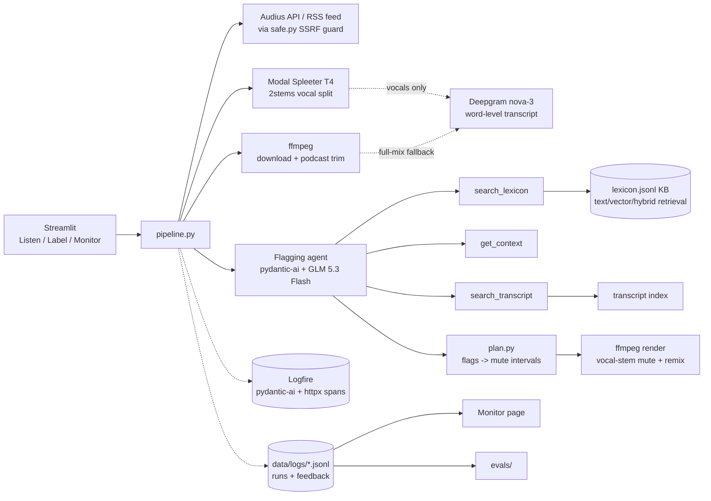
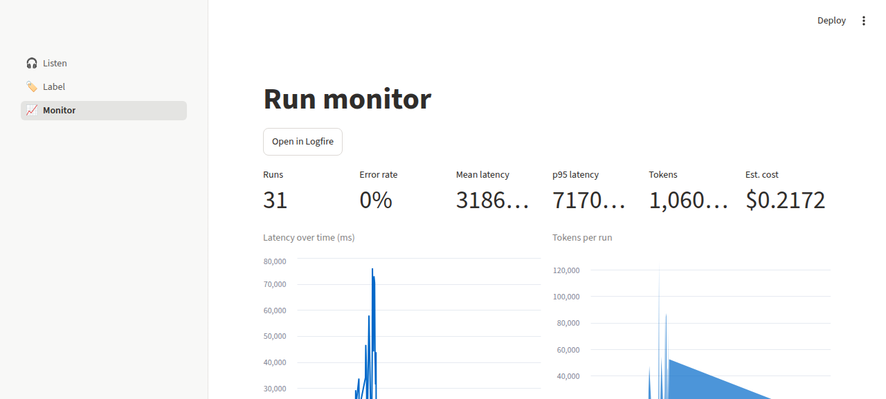

# Audio Angel — capstone agent

A Streamlit app that mutes words in songs and podcasts. Pick an Audius
track or a podcast episode, define what *you* want muted, and a Pydantic
AI agent (Fireworks GLM 5.3 Flash) with retrieval tools and a curated
slang lexicon flags the offending words. The app renders a muted MP3 —
only the vocal stem is silenced, the beat plays on — next to the
original so you can compare.

**Demo video:** _coming soon_

Companion posts by the author:
[Building the Audio Angel engine](https://thetexashacker.com/blog/building-the-audio-angel-engine/)
and [Agentic accessibility](https://thetexashacker.com/blog/agentic-accessibility/).

## At a glance

- Hybrid-retrieval knowledge base (129-entry slang lexicon; evaluated: hit@1 0.88)
- Pydantic AI agent with 3 tools + deterministic lexicon prematch
- 15 hand-labeled ground-truth tracks (agent-drafted, human-corrected)
- LLM judge + deterministic metrics (pair F1, word recall, cost)
- Prompt/chunk/retriever/threshold tuning → v4, min confidence 0.7
- Logfire instrumentation + Streamlit Monitor dashboard
- User feedback → feedback.jsonl → ground truth → re-eval loop
- Docker Compose, Makefile, uv, GitHub Actions CI, Streamlit UI
- Optional vocal separation: Spleeter 2stems on a Modal T4

## Problem

Content filters are binary: a song is either "explicit" or it isn't —
one coarse label applied to everyone. The idea here is **agentic
accessibility**: the listener defines their own boundaries and the
software adapts the media to fit. That means per-word mutes against
each listener's rules, not whole-song skips.

That is harder than it sounds. Lyrics arrive as sung audio, so a speech
transcriber mishears words; slang drifts faster than any dictionary;
artists self-censor with spellings like "f**k" and "sh!t"; common words
are offensive only in context ("high", "blow", "snow", "molly"); and a
topic rule like "politics" can span a whole verse rather than one word.
An LLM is good at the judgment calls but bad at slang coverage, so the
agent gets a small knowledge base it can query, plus transcript-wide
search and context tools.

## How it works

**prepare → flag → review → render**: download the track (Audius API or
podcast RSS) → optionally split vocals with Spleeter on Modal →
Deepgram word-level transcript (vocal stem when available) → the agent
flags each line against the rules → the listener reviews flags and can
thumb them up/down or report misses → ffmpeg mutes the vocal stem and
remixes the instrumental → A/B players, loudness-matched.



## Project structure

```
agent/
  app/streamlit_app.py     entrypoint: dotenv + logfire + st.navigation
  app/pages/listen.py      pick/flag/review+feedback/render page
  app/pages/label.py       ground-truth labeling (agent pre-fill)
  app/pages/monitor.py     KPIs + charts from runs/feedback JSONL
  app/components.py        shared source picker + helpers
  src/audio_angel/
    config.py              AgentConfig dataclass (tuned defaults)
    models.py              Word/Segment/Transcript/MuteRule/LineFlag/…
    pipeline/
      orchestrator.py        prepare/analyze/render orchestration
      audio.py               download to cache, ffmpeg podcast trim
      transcribe.py          Deepgram REST client + segmenting port
      separation.py          Modal Spleeter client + stems cache
      plan.py                flags -> merged mute intervals
      renderer.py            ffmpeg renderer (stem mute + remix, or mix gate)
    helpers/
      paths.py               data dir, cache dirs, safe filenames
      telemetry.py           logfire setup + runs.jsonl run records
      feedback.py            feedback.jsonl + runs.jsonl read/write
      ground_truth.py        GT schema + load/save/list helpers
    agent/prompts.py       versioned instructions + category definitions
    agent/flagger.py       the agent: tools, validator, flag_transcript
    kb/lexicon.py          lexicon schema + loader
    kb/search.py           text/vector/hybrid retrievers (+RRF)
    kb/transcript_index.py transcript segment indexing
    sources/safe.py        safeFetch port (https-only, redirects, caps)
    sources/audius.py      Audius search/trending/stream URL
    sources/podcasts.py    iTunes show search + RSS/Atom episodes
    data/lexicon.jsonl     129-entry slang/profanity lexicon
  modal_app/separate.py    Modal worker: Spleeter 2stems on one T4
  scripts/gen_drafts.py    batch-generate draft labels for review
  scripts/smoke.py         pipeline smoke test
  evals/
    judge.py               LLM-judge rubrics
    metrics.py             pair P/R/F1, word recall, dataset summary
    experiments.py         tuning grid (BASELINE/STAGE1/2/3)
    run_eval.py            pydantic_evals flagging eval
    tune.py                3-stage tuning driver
    improve.py             paired v3-vs-v4 comparison
    rescore.py             re-score saved flags vs current labels
    retrieval_eval.py      lexicon hit@k / MRR eval
    feedback_to_gt.py      feedback.jsonl -> ground_truth_feedback/
    manual_eval.py         human spot-check sheet + summary
    data/retrieval_queries.jsonl   50 retrieval probes
    data/ground_truth*/    human + feedback label files (+ draft/)
  tests/                   offline unit tests (httpx.MockTransport,
                           FunctionModel, fake embedder)
  tests/judge/             live judge tests (marker: judge)
  reports/                 eval artifacts (tables quoted below)
  docs/                    demo script + Monitor screenshot
  Dockerfile  docker-compose.yml  Makefile  .env.example
```

## Setup & run

Requirements: `uv`, `ffmpeg` (apt/brew), and API keys in `.env`:

```bash
cd agent
uv sync
cp .env.example .env   # then fill in keys
```

```
FIREWORKS_API_KEY=    # flagging agent + embeddings
DEEPGRAM_API_KEY=     # transcription
LOGFIRE_TOKEN=        # optional: remote Logfire
LOGFIRE_PROJECT_URL=  # optional: Monitor-page link
AUDIO_ANGEL_DATA_DIR= # optional override (default agent/data)
PODCAST_MAX_MINUTES=10
VOCAL_SEPARATION=music  # music (default) | all | off
#MODAL_TOKEN_ID=        # or rely on ~/.modal.toml (`modal token new`)
#MODAL_TOKEN_SECRET=
```

Run it:

```bash
make app                  # streamlit on :8501
docker compose up --build # or the whole thing in one container
```

Vocal separation is optional: deploy the Modal worker once with
`uv run modal deploy modal_app/separate.py` and set Modal creds; without
either, `VOCAL_SEPARATION=off` or missing creds falls back to the
full-mix path transparently. Optional Logfire: `uvx logfire auth`,
`uvx logfire projects new`, paste the write token into `.env`.

## Knowledge base & retrieval

`src/audio_angel/data/lexicon.jsonl` — **129 entries**, one JSON object
per line: `{id, term, variants[], category, definition, severity}`,
`category` one of the six rule categories (profanity, slurs, sexual,
drugs, violence, blasphemy). Definitions are one sentence and say when
the term is *not* offensive for ambiguous words. Hand-drafted to
emphasize slang, euphemisms, censored spellings and double meanings;
the slurs category lists real slurs because a filter can only catch
what it knows.

Three retrievers expose `search(query, k) -> [(doc_id, score)]` over
the same doc shape (`term + variants + definition`, keyword field
`category`):

- **text** — minsearch TF-IDF.
- **vector** — Fireworks `nomic-ai/nomic-embed-text-v1.5` (documents
  embedded as `search_document: …`, queries as `search_query: …`,
  batched by 64, cosine via numpy, doc embeddings cached by content hash).
- **hybrid** — reciprocal rank fusion (k=60) of both.

Retrieval eval (`make eval-retrieval`, 50 queries in
`evals/data/retrieval_queries.jsonl`, from `reports/retrieval.md`):

| method | hit@1 | hit@3 | hit@5 | MRR@10 |
|---|---|---|---|---|
| text | 0.740 | 0.920 | 0.940 | 0.827 |
| vector | 0.820 | 0.960 | 0.980 | 0.887 |
| **hybrid** | **0.880** | **0.960** | **0.980** | **0.924** |

**Hybrid is the default retriever** because it won the eval — its
biggest gain over text is misspellings (0.40 → 0.80 hit@1, n=5) and
censored spellings (0.00 → 0.33 hit@1, still the hardest type).

## The agent

- **Model**: `fireworks:accounts/fireworks/models/glm-5p3-flash`
  (pydantic-ai Fireworks provider, `FIREWORKS_API_KEY`).
- **Output**: `NativeOutput(FlagBatch)` — `{flags: [{line_index,
  rule_id, words[], confidence, reason}]}`; output retry budget 2.
- **Instructions**: versioned in `agent/prompts.py` — `v1` terse, `v2`
  workflow guidance, `v3` word-by-word + mild terms, **`v4` (current)**
  complete-line scanning, per-rule independence, no inferred
  obscenities, contextual-evidence requirements. Published versions are
  never edited — tuning changes add a new version.
- **Lexicon prematch** (`config.lexicon_prematch`, on): each chunk's
  lines are deterministically scanned for every lexicon term and
  variant before the model runs; hits are appended to the batch prompt
  as evidence ("evidence, not verdicts"), capped per line. Removes
  "never looked it up" misses while the model still judges each hit.
- **Tool-call budget**: 10 tool calls per chunk; the tools first return
  a "decide now" hint, then are removed from the toolset so the model
  must emit output (prevents runaway loops).

| tool | args | returns | why it exists |
|---|---|---|---|
| `search_lexicon` | `query, k=5` | top-k lexicon hits (term, category, definition) | slang/euphemism lookup when a word's meaning is uncertain |
| `get_context` | `line_index, radius=2` | neighbouring transcript lines (radius ≤5) | pronouns, double meanings, quotes, topic boundaries |
| `search_transcript` | `query, k=5` | matching transcript lines with indices | locate where a topic recurs across the track |

- **Validation**: an output validator enforces line-in-chunk,
  known-rule, and words-actually-in-line (token match against both
  `segment.text` and the joined word timestamps); violations raise
  `ModelRetry`, duplicate (line, rule) flags are dropped.
- `flag_transcript` chunks the transcript (`chunk_size` 25), runs chunks
  concurrently (semaphore 4), returns kept flags + **raw** flags
  (threshold re-scoring needs these), usage, latency, per-tool counts.

## Planning & rendering

`plan.py` maps each flag to timestamps: listed words → matching word
spans inside the segment (consumed once, in order; ±150 ms music /
±80 ms speech pad on the full mix, **−40/+70 ms on vocal stems**),
empty `words` → whole segment ±120 ms. A flag that can't be located
**falls back to the whole segment** and counts in `PlanResult.fallbacks`.
Intervals clamp to `[0, duration]` and merge across ≤150 ms gaps,
unioning rule ids.

`pipeline/renderer.py` writes `data/cache/renders/<source>-<hash>.mp3`. With stems
it mutes only the vocal stem (`volume=enable='between(t,…):volume=0'`),
remixes with the instrumental (`amix=inputs=2:normalize=0`), and applies
the separation gain — and the *original* player renders the same
stem mix with no mute intervals, so the A/B comparison is
loudness-matched. Without stems it gates the full mix directly.

## Vocal separation (Spleeter on Modal)

Sung vocals over a full mix transcribe poorly, and muting the whole mix
silences the beat. `modal_app/separate.py` is a Modal app
(`audio-angel-agent-separate`, one T4, CUDA 11.8 image with Spleeter
2.4.2 and baked 2stems weights) that splits vocals/instrumental in 30 s
chunks with 2 s of discarded context and returns both stems as FLAC plus
a clip-protection gain. Deploy once:

```bash
uv run modal deploy modal_app/separate.py
```

`separation.py` gates it by env (`VOCAL_SEPARATION`: `music` default,
`all`, `off`) and by creds (`MODAL_TOKEN_ID`/`SECRET` or
`~/.modal.toml`). Stems cache in `data/cache/stems/<source>/`; Deepgram
transcribes the vocal stem (cached as `<source>.vocals.json`), so word
timings come from clean vocals — measurably cleaner on sung hooks than
the full mix. A separation failure warns in the UI and falls back to
the full-mix path.

## Testing

- `make test` — 91 offline unit tests: every source/retriever/planner/
  renderer path via `httpx.MockTransport`, the agent via pydantic-ai's
  `FunctionModel`/`TestModel`, vector search via a hashing fake
  embedder; `ALLOW_MODEL_REQUESTS=False` so nothing can hit a real API.
- `make test-judge` — live tests marked `judge` (skipped without
  `FIREWORKS_API_KEY`): three hand-written fixtures asserted by both
  deterministic F1 and `LLMJudge`.
- CI (`.github/workflows/agent.yml`) runs ruff check + format check +
  the offline suite, then a docker image build, on every push/PR
  touching `agent/**`.

## Evaluation

### Ground truth

15 tracks hand-labeled by the author in the Label page
(`evals/data/ground_truth/*.json` — each file carries a transcript
snapshot + expected flags, so evals never call Deepgram or Modal). The
Label page's "pre-fill" runs the agent to draft flags, but drafts go to
a separate gitignored `ground_truth_draft/` directory and are never
evaluated; every label actually used was reviewed and corrected by a
human before saving (`labeled_by="human"`). Honest disclosure: drafts
were agent-prefilled and then human-corrected, and **5 labels were
corrected after review**: 4 in `reports/feedback-review.md` (removed
slur/profanity mistakes, added sexual flags a note identified), plus
`aud:PgwGXNX`, where "asshole" was added as profanity by the author's
decision.

### Metrics

`evals/metrics.py`: per case, (line_index, rule_id) pairs score
precision/recall/F1; word recall measures token coverage of expected
words on matched pairs (multiset, normalized like the planner). Dataset
summary reports micro and macro F1, mean word recall, LLM judge pass
rate + mean 0–1 score (rubrics in `evals/judge.py`), mean latency,
input/output tokens, and est. cost ($0.15/M input + $0.50/M output).
Failed cases count as all-misses, not dropped rows.

### What one eval case runs

Per song: load saved transcript (no Spleeter/Deepgram in evals) → build
indexes ~1 s → agent ~44 s avg (25-line chunks, ≤4 concurrent, 1–15 GLM
calls) → score instantly → 2 judge calls ~24 s avg. One pass over 15
songs ≈ 17 min. Cases run one at a time because concurrent cases
throttled Fireworks — and failed cases score as all-misses, which is
what invalidated an earlier tuning grid (reported honestly rather than
hidden).

### Results

**First eval (v3, 15 cases)** — the baseline that motivated tuning:
precision 0.473, recall 0.768, micro F1 0.585, macro F1 0.527, word
recall 0.977, judge pass 53%, mean latency 45 s, cost $0.13. High
recall, low precision: the agent found most of what should be muted but
over-flagged — exactly what the human review step exists for.

**v3 vs v4 on the same corrected labels** (`reports/feedback-comparison.md`):

| prompt | precision | recall | micro F1 | macro F1 | word recall | judge pass | judge score |
|---|---|---|---|---|---|---|---|
| v3 | 0.465 | 0.839 | 0.599 | 0.590 | 0.972 | 0.600 | 0.790 |
| v4 | 0.592 | 0.804 | 0.682 | 0.654 | 0.921 | 0.600 | 0.753 |

**Threshold sweep** (saved raw flags re-scored against current labels,
`reports/feedback-rescored.md` — no new model calls):

| prompt | threshold | precision | recall | micro F1 | macro F1 | word recall |
|---|---|---|---|---|---|---|
| v3 | 0.5 | 0.475 | 0.842 | 0.608 | 0.657 | 0.975 |
| v3 | 0.7 | 0.621 | 0.719 | 0.667 | 0.711 | 0.971 |
| v3 | 0.8 | 0.649 | 0.649 | 0.649 | 0.681 | 0.945 |
| v4 | 0.5 | 0.605 | 0.807 | 0.692 | 0.720 | 0.929 |
| v4 | 0.7 | 0.630 | 0.807 | **0.708** | **0.789** | 0.929 |
| v4 | 0.8 | 0.631 | 0.719 | 0.672 | 0.706 | 0.925 |

#### Ablations (v4)

One variable changed at a time from the v4 default, scored at the 0.7
threshold against the current labels (`reports/ablations.md`, via
`evals/rescore.py`; 0 failed cases in every run):

| variant | precision | recall | micro F1 | macro F1 | agent latency / song | cost (15 songs) |
|---|---|---|---|---|---|---|
| **chunk 25, tools on (default)** | 0.630 | **0.807** | **0.708** | **0.789** | 36.9 s | $0.103 |
| chunk 10 | **0.634** | 0.789 | 0.703 | 0.723 | 31.4 s | $0.111 |
| chunk 50 | 0.583 | 0.737 | 0.651 | 0.703 | 36.6 s | $0.077 |
| tools off (prematch evidence only) | 0.620 | 0.772 | 0.688 | 0.734 | 25.7 s | $0.039 |

50-line chunks lose the most recall; 10-line chunks trade a little
recall for precision. The tools add recall (0.772 → 0.807)
at ~2.6× the cost. With 15 songs these gaps are small, so treat them as
direction, not proof.

**Selected configuration:** prompt v4 · chunk 25 · hybrid retrieval ·
tools on · lexicon prematch on · **min confidence 0.7** — the v4 row at
0.7 wins micro F1 (0.708) and macro F1 (0.789) of every configuration
evaluated, and is the default in `config.py`.

### Manual evaluation

The author reviewed the agent's output per track while labeling (the
Label page exists for exactly this) and wrote per-track notes stored in
the ground-truth files. `reports/feedback-review.md` records the
evidence: where the judge's explanations and the human notes agreed,
the label corrections that resulted, and the still-unresolved policy
questions (e.g. whether "sexy" belongs under an explicit-acts rule,
whether a bare "guns" counts as graphic violence). `make manual-sheet` /
`make manual-summary` regenerate the sheet and the human-vs-judge
agreement report.

**Caveat:** v4 was developed on these same 15 tracks, so every number
above is a development-set result, not a held-out estimate.

### How to run the evals

```bash
make eval            # flagging eval on human ground truth
make eval-retrieval  # lexicon hit@k / MRR table
make eval-tune       # 3-stage prompt/chunk/retriever/threshold tuning
make eval-feedback   # eval on feedback-derived ground truth
uv run python evals/improve.py   # paired v3-vs-v4 comparison
uv run python evals/rescore.py   # re-score saved flags vs current labels
uv run python evals/rescore.py reports/eval-*.json   # ablation table
uv run python evals/run_eval.py --no-judge --config chunk_size=50   # one ablation run
```

## Monitoring

- **Logfire**: `setup_logfire()` instruments pydantic-ai + httpx; spans
  wrap download/separate/transcribe/analyze/render and each agent
  chunk. With a token, open the project's Live view; a useful dashboard
  query is `SELECT * FROM records WHERE span_name LIKE 'flagger.chunk%'`
  for chunk-level latency/cost.
- **Local JSONL**: every run appends to `data/logs/runs.jsonl`
  (`{run_id, ts, source_key, title, kind, rule_ids, config, n_segments,
  n_flags, n_raw_flags, latency_ms, requests, input_tokens,
  output_tokens, tool_calls, separation, error}`) and every verdict to
  `data/logs/feedback.jsonl`.
- **Monitor page**: KPIs (runs, error rate, mean/p95 latency, tokens,
  est. cost), charts over time, per-config breakdown, per-tool call
  counts, feedback approval rate, last-20-runs table, recent errors.



## User feedback → ground truth

The review table on Listen has a thumbs up/down verdict per flag plus a
"report a missed word" form; clicking **Save feedback** appends the
verdicts to `feedback.jsonl`. `make feedback-to-gt` turns them into
`evals/data/ground_truth_feedback/` files (up + missed − down, latest
run wins per source), which `make eval-feedback` scores exactly like the
human set — logs become new evaluation data, closing the loop.

## Reproducibility

`uv.lock` pins every dependency; the Dockerfile reproduces the runtime.
Ground truth (with transcript snapshots), the lexicon, and the 50
retrieval queries are committed, so evals run without Deepgram or
Modal; LLM outputs vary run to run, while `evals/rescore.py` re-scoring
of saved flags against current labels is fully deterministic with no
model calls. Audius
audio is public and keyless; live transcription/flagging needs
`DEEPGRAM_API_KEY`/`FIREWORKS_API_KEY`, and vocal separation needs a
deployed Modal worker (optional, with graceful fallback).

## Limitations & next steps

- ASR on sung vocals still mishears words even off the isolated stem;
  timestamp error accumulates on long tracks.
- Spleeter leaves separation artifacts — very aggressive mutes can clip
  vocal tails, and ad-libs sometimes leak into the instrumental.
- Slang drifts faster than the lexicon; the eval set is small and
  dev-set (v4 was tuned on it — no held-out claim).
- The LLM judge shares the same model family as the agent (GLM 5.3
  Flash), so judge agreement is partly self-assessment.
- Not real-time: a 4-minute song takes ~1 min of separation + ~45 s of
  flagging; streaming-provider access would be needed for catalog
  breadth (Audius only scratches it).
- No cloud deployment yet — the Modal worker is the only hosted piece;
  the app itself runs locally or via `docker compose up`.

## Self-evaluation

| criterion | max | self | evidence |
|---|---|---|---|
| Problem description | 2 | 2 | [Problem](#problem) — from the author's blog, with the failure modes that motivated each component |
| Knowledge base & retrieval | 2 | 2 | [KB & retrieval](#knowledge-base--retrieval) — 3 methods, eval table, hybrid wins |
| Agents & LLM | 3 | 3 | [The agent](#the-agent) — tools table, validator, prematch, budget, versioned prompts |
| Code organization | 2 | 2 | [Project structure](#project-structure) — src layout, layered pipeline, one module per concern |
| Testing | 2 | 2 | [Testing](#testing) — 91 offline tests, marker-separated live tests |
| Evaluation | 3 | 3 | [Evaluation](#evaluation) — metrics, tuning sweep, results tables |
| Eval bonus: hand-crafted GT | 2 | 2 | [Ground truth](#ground-truth) — 15 labeled tracks w/ transcript snapshots |
| Eval bonus: manual eval | 2 | 2 | [Manual evaluation](#manual-evaluation) — per-track review + feedback-review.md |
| Monitoring | 2 | 2 | [Monitoring](#monitoring) — Logfire spans + Monitor page |
| Monitoring bonus: user feedback | 1 | 1 | [Feedback loop](#user-feedback--ground-truth) — verdicts + missed-word form |
| Monitoring bonus: logs → GT | 2 | 2 | feedback_to_gt.py + `make eval-feedback` |
| Reproducibility | 2 | 2 | [Reproducibility](#reproducibility) — uv.lock, committed GT/lexicon/queries |
| Docker | 1 | 1 | Dockerfile: slim + ffmpeg + uv, non-root, healthcheck |
| compose up starts the system | 2 | 2 | `docker compose up` runs the full app; the Modal worker is an external managed service (one `modal deploy`, creds via env) — documented above |
| Makefile | 1 | 1 | `make help` lists every target |
| uv | 1 | 1 | uv project, `uv sync`, uv.lock committed |
| CI/CD | 2 | 2 | `.github/workflows/agent.yml`: lint + offline tests + docker build on every push/PR |
| UI | 1 | 1 | Streamlit: Listen/Label/Monitor pages, review table, A/B players |
| Cloud deployment | 2 | 0 | not deployed — the Modal worker is the only hosted component |
