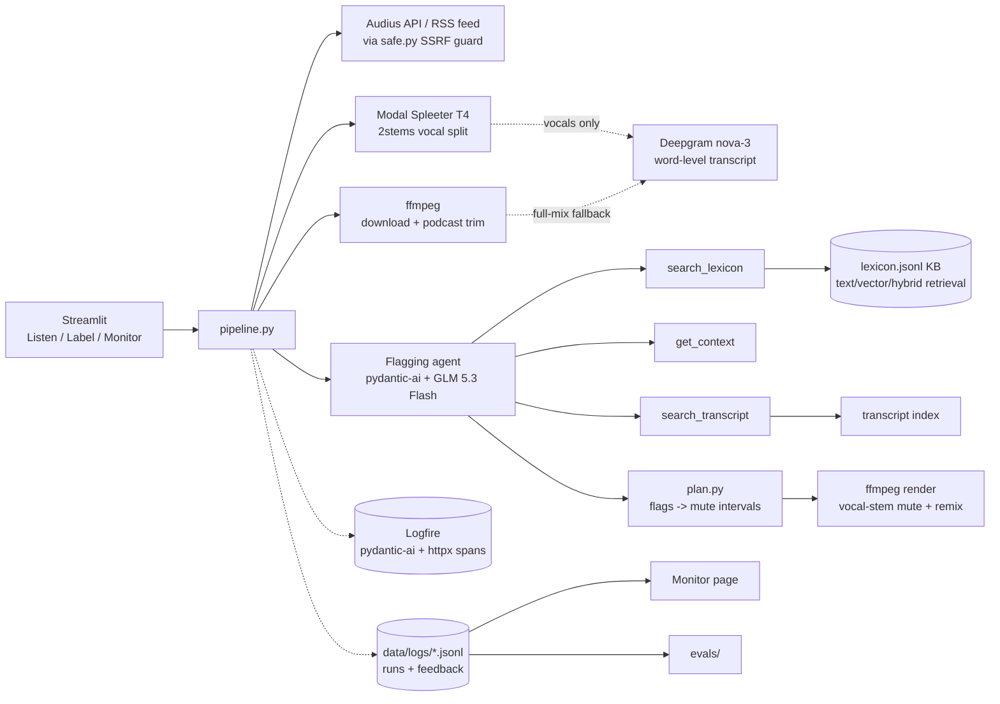

# Audio Angel — capstone agent

A Streamlit app that mutes words in songs and podcasts. Pick an Audius
track or a podcast episode, define what to mute, and a Pydantic AI agent
(Fireworks GLM 5.3 Flash) with retrieval tools and a curated lexicon
flags the offending words. The app renders a muted MP3 next to the
original so you can compare. Logfire instruments the pipeline; every run
is also logged locally as JSONL for offline evaluation.

## Problem & demo flow

Family listening needs per-word mutes, not whole-song skips. Speech
transcripts give word-level timing; the hard part is deciding *which*
words break a listener's rules — slang, censored spellings ("f**k",
"sh!t"), ambiguous words ("high", "blow", "snow", "molly") and free-form
topics. An LLM is good at the judgment but bad at slang coverage, so the
agent gets a small knowledge base it can query, plus transcript-wide
search and context tools.

Flow: **Listen page** → pick source → define rules (6 categories +
custom terms + topics) → *Find what to mute* (download → isolate
vocals → transcribe → flag) → review flags with verdicts → *Render
muted audio* → compare.

## Architecture



## Project structure

```
agent/
  app/streamlit_app.py     entrypoint: dotenv + logfire + st.navigation
  app/pages/listen.py      pick/flag/review+feedback/render page
  app/pages/label.py       ground-truth labeling (agent pre-fill)
  app/pages/monitor.py     KPIs + charts from runs/feedback JSONL
  app/components.py        shared source picker + helpers
  src/audio_angel/
    config.py              AgentConfig dataclass (tuning defaults)
    models.py              Word/Segment/Transcript/MuteRule/LineFlag/…
    paths.py               data dir, cache dirs, safe filenames
    audio.py               download to cache, ffmpeg podcast trim
    transcribe.py          Deepgram REST client + segmenting port
    ground_truth.py        GT schema + load/save/list helpers
    feedback.py            feedback.jsonl + runs.jsonl read/write
    telemetry.py           logfire setup + runs.jsonl run records
    pipeline.py            prepare/analyze/render orchestration
    plan.py                flags -> merged mute intervals
    render.py              ffmpeg renderer (stem mute + remix, or full-mix gate)
    separation.py          Modal Spleeter client + stems cache
    agent/prompts.py       versioned instructions + category definitions
    agent/flagger.py       the agent: tools, validator, flag_transcript
    kb/lexicon.py          lexicon schema + loader
    kb/search.py           text/vector/hybrid retrievers (+RRF)
    kb/transcript_index.py transcript segment indexing
    sources/safe.py        safeFetch port (https-only, redirects, caps)
    sources/audius.py      Audius search/trending/stream URL
    sources/podcasts.py    iTunes show search + RSS/Atom episodes
    data/lexicon.jsonl     ~129-entry slang/profanity lexicon
  modal_app/separate.py    Modal worker: Spleeter 2stems on one T4
  scripts/gen_drafts.py    batch-generate draft labels for review
  scripts/smoke.py         pipeline smoke test
  evals/
    judge.py               LLM-judge rubrics
    metrics.py             pair P/R/F1, word recall, dataset summary
    experiments.py         tuning grid (BASELINE/STAGE1/2/3)
    run_eval.py            pydantic_evals flagging eval
    tune.py                3-stage tuning driver
    retrieval_eval.py      lexicon hit@k / MRR eval
    feedback_to_gt.py      feedback.jsonl -> ground_truth_feedback/
    manual_eval.py         human spot-check sheet + summary
    data/retrieval_queries.jsonl   50 retrieval probes
    data/ground_truth*/    human + feedback label files (+ draft/)
  tests/                   offline unit tests (httpx.MockTransport,
                           FunctionModel, fake embedder)
  tests/judge/             live judge tests (marker: judge)
  Dockerfile  docker-compose.yml  Makefile  .env.example
```

## Setup

```bash
cd agent
uv sync                      # python deps incl. dev
# ffmpeg must be installed (apt/brew); used for trims + renders.
cp .env.example .env         # then fill in keys
```

`.env`:

```
FIREWORKS_API_KEY=    # flagging agent + embeddings
DEEPGRAM_API_KEY=     # transcription
LOGFIRE_TOKEN=        # optional: remote Logfire
LOGFIRE_PROJECT_URL=  # optional: Monitor-page link
AUDIO_ANGEL_DATA_DIR= # optional override (default agent/data)
PODCAST_MAX_MINUTES=10
VOCAL_SEPARATION=music  # music (default) | all | off
#MODAL_TOKEN_ID=        # or rely on ~/.modal.toml (`modal token new`)
#MODAL_TOKEN_SECRET=
```

Optional Logfire setup: `uvx logfire auth` then
`uvx logfire projects new` and paste the write token into `.env`.

## Run

```bash
make app                 # streamlit on :8501
# or everything-in-one:
docker compose up --build
```

## The knowledge base

`data/lexicon.jsonl` — 129 entries, one JSON object per line:
`{id, term, variants[], category, definition, severity}` where
`category` is one of the six rule categories (profanity, slurs, sexual,
drugs, violence, blasphemy). Definitions are one sentence and say *when
the term is NOT offensive* for ambiguous words. It was hand-drafted to
emphasize slang, euphemisms, censored spellings and double meanings
("high", "blow", "snow", "hell", "molly", "420", "thot"); the slurs
category lists real slurs because a filter can only catch what it knows.

Three retrievers expose `search(query, k) -> [(doc_id, score)]` over the
same doc shape (`term + variants + definition`, keyword field
`category`):

- **text** — minsearch TF-IDF.
- **vector** — Fireworks `nomic-ai/nomic-embed-text-v1.5` via the OpenAI
  SDK (documents embedded as `search_document: …`, queries as
  `search_query: …`, batched by 64, cosine via numpy, doc embeddings
  cached by content hash).
- **hybrid** — reciprocal rank fusion (k=60) of both.

**Retrieval eval** (`make eval-retrieval`, `evals/data/retrieval_queries.jsonl`):

| method | hit@1 | hit@3 | hit@5 | MRR@10 |
|---|---|---|---|---|
| text | 0.740 | 0.920 | 0.940 | 0.827 |
| vector | 0.820 | 0.960 | 0.980 | 0.887 |
| **hybrid** | **0.880** | **0.960** | **0.980** | **0.924** |

Hybrid is the default retriever. Its biggest gains over text alone are
censored spellings (0.33 → 0.33/0.67 hit@1/5 — still the hardest type)
and misspellings (0.40 → 1.00 hit@1).

## The agent

- **Model**: `fireworks:accounts/fireworks/models/glm-5p3-flash`
  (pydantic-ai Fireworks provider, `FIREWORKS_API_KEY`).
- **Output**: `NativeOutput(FlagBatch)` — `{flags: [{line_index, rule_id,
  words[], confidence, reason}]}`; `output_retries=2` budget for the
  validator.
- **Instructions**: versioned in `agent/prompts.py` (`v1` terse, `v2`
  adds workflow guidance, `v3` word-by-word checking + mild terms +
  kept judgment calls — current default); versions are an eval
  parameter — never edited in place.
- **Lexicon prematch** (`config.lexicon_prematch`, default on): each
  chunk's lines are deterministically scanned for every lexicon term
  and variant before the model runs, and the hits are appended to the
  batch prompt as evidence ("evidence, not verdicts"). This removes
  "never looked the word up" misses while the model still judges each
  hit by its definition. Works with `tools_enabled=False` too.
- **Tools** (registered only when `config.tools_enabled`):
  - `search_lexicon(query, k=5)` — KB lookup for slang/euphemisms;
    called when a word's meaning is uncertain.
  - `get_context(line_index, radius=2)` — neighbouring lines (radius
    ≤5); called for pronouns, double meanings, quotes.
  - `search_transcript(query, k=5)` — line-level transcript search;
    called for topic rules to locate where a topic recurs.
- **Validation**: an `output_validator` enforces line-in-chunk,
  known-rule, and words-actually-in-line (token match against both
  `segment.text` and the joined word timestamps); violations raise
  `ModelRetry`, duplicates of (line, rule) are dropped.
- `flag_transcript` chunks the transcript (`chunk_size`, default 25),
  runs chunks concurrently (semaphore 4), returns kept flags + **raw**
  flags (threshold tuning re-scores these), usage, latency, per-tool
  call counts.

## Planning & rendering

`plan.py` maps each flag to timestamps: listed words → matching word
spans inside the segment (consumed once, in order; ±150 ms music /
±80 ms speech pad), empty `words` → whole segment ±120 ms. A flag that
can't be located **falls back to the whole segment** and is counted in
`PlanResult.fallbacks`. Intervals clamp to [0, duration] and merge
across ≤150 ms gaps, unioning rule ids. `render.py` writes
`data/cache/renders/<source>-<hash>.mp3` (the hash keys on whether
stems were used).

## Vocal separation (Spleeter on Modal)

Sung vocals over a full mix transcribe poorly, and muting the whole mix
silences the beat. `modal_app/separate.py` is a Modal app
(`audio-angel-agent-separate`, one T4, CUDA 11.8 image with Spleeter
2.4.2 and baked 2stems weights) that downloads the source, splits
vocals/instrumental in 30 s chunks with 2 s context, and returns both
stems as FLAC plus a clip-protection gain. Deploy once:

```bash
uv run modal deploy modal_app/separate.py
```

`separation.py` gates it by env (`VOCAL_SEPARATION`: `music` default,
`all`, `off`) — podcasts are off by default — and by creds
(`MODAL_TOKEN_ID`/`SECRET` or `~/.modal.toml`). Stems land in
`data/cache/stems/<source>/`; Deepgram then transcribes the vocal stem
(cached as `<source>.vocals.json`) so word timings come from clean
vocals. `plan.py` uses tighter pads on vocal stems (−40/+70 ms) than on
the full mix (±150 ms). `render.py` gates only the vocal stem, remixes
it with the untouched instrumental via `amix`, and applies the worker's
gain; the Listen page renders both players from stems so the muted A/B
is loudness-matched to its original. A separation failure warns and
falls back to the full-mix path.

## Testing

- `make test` — offline unit tests (HTTP via `httpx.MockTransport`, the
  agent via `FunctionModel`/`TestModel`, vector search via a hashing
  fake embedder; `ALLOW_MODEL_REQUESTS=False`).
- `make test-judge` — live tests marked `judge` (skipped without
  `FIREWORKS_API_KEY`): three hand-written fixtures asserted by both
  deterministic F1 and `LLMJudge`.

## Evaluation

- **Ground truth**: the Label page writes `evals/data/ground_truth/*.json`
  (transcript snapshot + expected flags, so evals never call Deepgram).
  Feedback-derived files go to `ground_truth_feedback/`.
- **Drafts**: `uv run python scripts/gen_drafts.py --n 20` pre-runs
  tracks end-to-end (separation → transcript → agent with a random
  rule set) and saves them as `labeled_by="draft"` under
  `ground_truth_draft/` — review material only, invisible to the
  evals. Open each `[draft]` in the Label page's file picker, correct
  the flags, and save to promote it to human ground truth.
- **Metrics** (`evals/metrics.py`): pair (line, rule) P/R/F1, word-token
  recall on matched pairs, micro/macro aggregates, judge pass rate,
  latency, tokens, est. cost ($0.15/M in + $0.50/M out).
- **Flagging eval**: `make eval` (or `eval-smoke`) runs pydantic_evals
  with `PairMetrics` + `WordRecall` evaluators and two `LLMJudge`s
  (pass/fail rubric + 0–1 score) → `reports/eval.md` + timestamped JSON.
- **Tuning**: `make eval-tune` — stage 1 prompt×chunk, stage 2
  retriever/tools ablation, stage 3 thresholds on raw flags →
  `reports/tuning.md`. Current defaults in `config.py` come from this.
- **Manual eval**: `make manual-sheet` → CSV for human verdicts;
  `make manual-summary` → agreement report vs the LLM judge.

| config | micro F1 | macro F1 | word recall | judge | latency | cost |
|---|---|---|---|---|---|---|
| v3-chunk25-hybrid-tools-pre-conf0.5 (default, 15 human labels) | 0.585 | 0.527 | 0.977 | 53% | 45s | $0.13 |

First eval on 15 hand-labeled drafts: recall 0.77, precision 0.47 —
the agent finds most of what should be muted but over-flags (the
human-review step exists for exactly this). The tuning grid
(`make eval-tune`) picks the final defaults from this dataset.

## Monitoring

- **Logfire**: `setup_logfire()` instruments pydantic-ai + httpx; spans
  wrap download/transcribe/analyze/render and each agent chunk. With a
  token, open the project's Live view; a useful dashboard query is
  `SELECT * FROM records WHERE span_name LIKE 'flagger.chunk%'`
  ordered by start_timestamp for chunk-level latency/cost.
- **Monitor page**: reads `data/logs/runs.jsonl` (`{run_id, ts,
  source_key, title, kind, rule_ids, config, n_segments, n_flags,
  n_raw_flags, latency_ms, requests, input_tokens, output_tokens,
  tool_calls, error}`) and `feedback.jsonl` for KPIs, trends, per-config
  breakdowns and approval rates.

## Feedback loop

Listen-page verdicts (👍/👎 per flag, plus "report a missed word") land
in `feedback.jsonl`; `make feedback-to-gt` turns them into
`ground_truth_feedback/` files (up + missed − down), which
`make eval-feedback` scores like the human set.

## Reproducibility

Audius audio is public and keyless; transcripts are snapshotted into
ground-truth files so evals are deterministic and offline. Live
transcription/flagging needs `DEEPGRAM_API_KEY`/`FIREWORKS_API_KEY`;
vector retrieval needs `FIREWORKS_API_KEY` (text/hybrid degrade
gracefully — the retrieval eval reports text-only when the key is
absent). Vocal separation needs a deployed Modal worker and is fully
optional — with `VOCAL_SEPARATION=off` or no Modal creds the pipeline
uses the full-mix path. uv.lock pins every dependency.

## Deployment

`agent/Dockerfile` (python:3.13-slim + ffmpeg + uv, non-root,
`/_stcore/health` healthcheck, `PORT` env) and `docker-compose.yml`
(persistent `data/` + `evals/data/` volumes) run the whole system with
`docker compose up`. Not deployed yet; Railway notes: set the env vars,
keep the data volume mounted, expose `PORT`.
